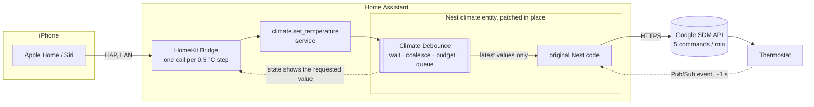
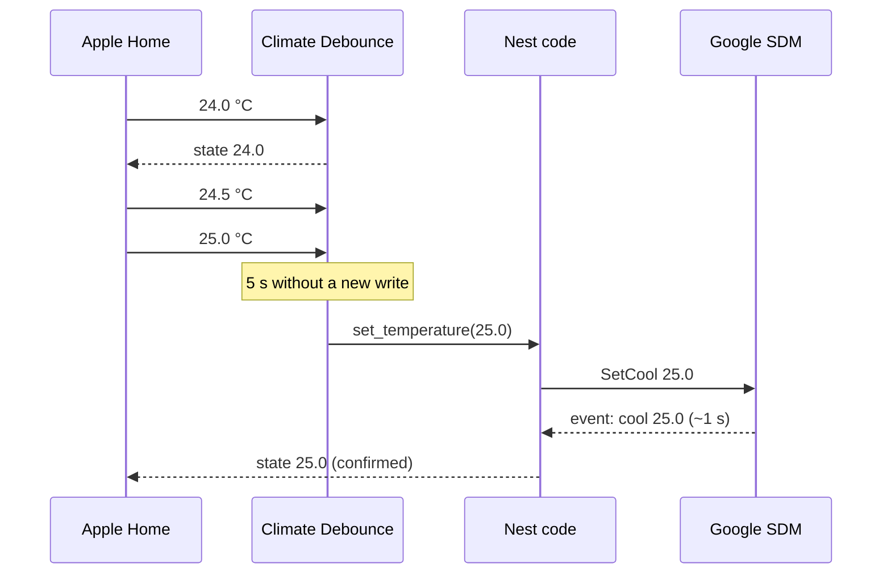

# Climate Debounce

A Home Assistant custom integration that stops cloud thermostats from dropping
your changes. It holds the commands sent to one climate entity until you stop
adjusting, then sends only the final values, in order, within a per-minute
command budget.

It was written for **Google Nest thermostats (SDM API) controlled from Apple
Home through the HomeKit Bridge**, but it works on any `climate` entity.

## The problem

When you drag the temperature in Apple Home, the HomeKit Bridge turns every
0.5 °C step into its own `climate.set_temperature` call. Google's Smart Device
Management API allows **5 commands per minute per thermostat** (and 100 per
hour), across all projects. A few drags are enough to hit that limit. A real
log from a Nest Learning Thermostat (3rd gen):

| t | Apple Home sent | result |
|---|-----------------|--------|
| 0.0 s | 75 °F | applied |
| +1.0 s | 76 °F | applied |
| +3.0 s | 75 °F | applied |
| +3.2 s | 74 °F | **overtaken by the 75 °F sent 0.19 s earlier** |
| +6.6 s | 76 °F | applied |
| +6.8 s | 77 °F | **429 RESOURCE_EXHAUSTED** |
| +9.4 – 12.8 s | 75, 74, 73 °F | **429 RESOURCE_EXHAUSTED** |

Three things go wrong:

1. **Rate limit.** Nine commands in 13 seconds; the last four were rejected and
   the thermostat stayed at 76 °F while the phone showed 73 °F.
2. **Reordering.** Calls for the same thermostat run concurrently, so an
   earlier, slower request can land after a later one.
3. **Setpoints dropped after a mode change.** The Nest integration picks
   SetHeat, SetCool or SetRange from its cached mode, which only updates when
   Google pushes an event about 1–2 s later. Turn the thermostat on and set a
   temperature right away, and the setpoint is silently ignored.

This has been reported since 2021
([home-assistant/core#49095](https://github.com/home-assistant/core/issues/49095),
[homebridge-google-nest-sdm#99](https://github.com/potmat/homebridge-google-nest-sdm/issues/99)),
but the limit is on Google's side and neither the HomeKit Bridge nor the Nest
integration debounces.

## What it does



For each configured entity:

- **Wait and coalesce.** Writes are held until nothing new has arrived for
  `delay` seconds (default 5), then only the latest mode and setpoints are
  sent. Continuous fiddling is flushed after at most 15 s (or 3 × `delay`).
- **Budget.** It counts its own commands and never sends more than
  `commands_per_minute` (default 5) in any 60 s. When the budget is used up it
  waits instead of sending into a 429. If a 429 still comes back (another app
  used the quota), it keeps the latest values and retries once the window
  rolls over, up to 3 times.
- **Queue.** One command at a time per thermostat, mode before setpoint, so a
  later value always wins.
- **Skip no-ops.** Nothing is sent when the device already has the value,
  within half a display step (0.3 °C, or 0.55 °C for entities in °F).
- **Optimistic state.** While a value is waiting, or sent but not yet reported
  back, the entity reports the requested value. Apple Home's slider does not
  snap back, and the Nest code reads the new mode when it chooses between
  SetHeat, SetCool and SetRange (fixing problem 3).

Preset (eco) and fan commands are not debounced, but they go through the same
queue and budget, so they can wait for a free slot instead of failing with a
429.



### Where it runs

It does not add a new entity. When the configured entity appears, the
integration wraps the methods and properties of that entity's class
(`async_set_temperature`, `async_set_hvac_mode`, `hvac_mode`,
`target_temperature`, `target_temperature_low/high`, `precision`, plus preset
and fan as pass-through). So HomeKit, Google Assistant, Alexa, dashboards and automations
all keep using the same entity and all go through the buffer. Other entities
of the same class that you did not configure are untouched, and removing the
integration restores the original class.

## Install

**HACS:** HACS → ⋮ → Custom repositories → add
`https://github.com/eric1932/ha-climate-debounce` as an *Integration*, install
**Climate Debounce**, restart Home Assistant.

**Manual:** copy `custom_components/climate_debounce` into your
`config/custom_components/`, restart Home Assistant.

## Configure

**UI:** Settings → Devices & services → Add integration → *Climate Debounce*,
pick the thermostat. Add one entry per thermostat. Change the options later
with *Configure*.

**YAML** (imported into the UI on every start, so YAML wins):

```yaml
climate_debounce:
  - entity_id: climate.thermostat
    delay: 5                # seconds without a change before sending
    commands_per_minute: 5  # Google Nest SDM allows 5
    one_decimal: false      # see below
```

| option | default | meaning |
|---|---|---|
| `delay` | 5 s | Quiet time before the latest values are sent. In testing, separate drags on the phone came 1–3.5 s apart, so 5 s merges a whole adjustment into one command. The thermostat itself takes minutes to change the room, so the wait is not noticeable. |
| `commands_per_minute` | 5 | Upper bound for any 60 s window. Leave room if something else also sends commands to the thermostat. |
| `one_decimal` | off | Report this thermostat's temperatures to 0.1°. Only needed when Home Assistant uses °F but the thermostat or Apple Home uses °C. Without it Home Assistant rounds setpoints to whole °F, so 23.5 °C comes back to Apple Home as 23.3 °C and the slider jumps right after you let go. With it the state shows 74.3 °F and the round trip is exact. The current temperature is shown with a decimal too (71.6 °F). |

Changing options in the UI applies them immediately, without dropping
changes that are waiting to be sent. With YAML, the YAML values are imported
again on every start.

Debug logging:

```yaml
logger:
  logs:
    custom_components.climate_debounce: debug
```

You will see lines like
`climate.thermostat: sent temperature=23 (4 write(s) coalesced)`.

## Trade-offs

- A service call returns as soon as the values are queued. Errors from the
  device (other than rate limits, which are retried) are logged, not raised to
  the caller, and the entity goes back to reporting the device's real values.
- For up to 30 s after sending, the entity reports the requested value even if
  the device has not confirmed it yet. After that it reports whatever the
  device says (for example when a Nest ignores a setpoint because it is off).
- Changes still waiting when Home Assistant shuts down, or when the entry is
  removed, are dropped.
- It patches the entity's class at runtime. If a future Home Assistant release
  renames these methods, the integration fails to attach and logs an error;
  your thermostat keeps working without it.
- Renaming the entity_id requires re-adding the entry.
- Home Assistant rounds climate setpoints to whole degrees when its unit
  system is °F, whatever the device itself uses. If Apple Home is in °C it
  moves in 0.5 °C steps, so right after you let go the slider moves to the
  nearest whole °F (23.5 °C → 74 °F → 23.3 °C). The command sent to the device
  still carries the exact value you chose. This happens without the
  integration too, once the device reports back. Turn on `one_decimal` to
  avoid it.

## Development

`tests/sim_buffer.py` runs the buffer against a fake Nest-like cloud (rate
limit, latency, delayed state reports) with time scaled down. It needs Home
Assistant importable, e.g. inside the Home Assistant container:

```sh
python3 tests/sim_buffer.py
```

It checks, against the unpatched behaviour: drags stay under the limit and the
last value lands, a tight budget is respected, a setpoint right after a mode
change lands, Siri-style mode + temperature sends two commands, duplicates
send nothing, the UI does not snap back, a 429 is retried, and a slow earlier
request can no longer overwrite a later one. It also covers going back to the
old value before the device confirms, budgets of 1 and 2 with mode, setpoint
and preset changes mixed in, a setpoint the device ignores, a reloaded entity
object, patching a subclass, and the `one_decimal` option.

Tested with Home Assistant 2026.7 and a Nest Learning Thermostat (3rd gen)
through the HomeKit Bridge. Two rounds of dragging in Apple Home produced 14
`set_temperature` calls (5 within 3 s, then 9 within 9.4 s); the integration
sent 2 commands, about 5.6 s after each round ended, with no 429s. Without it,
9 calls in 13 s had produced 9 commands, 4 of them rejected.

## License

MIT
